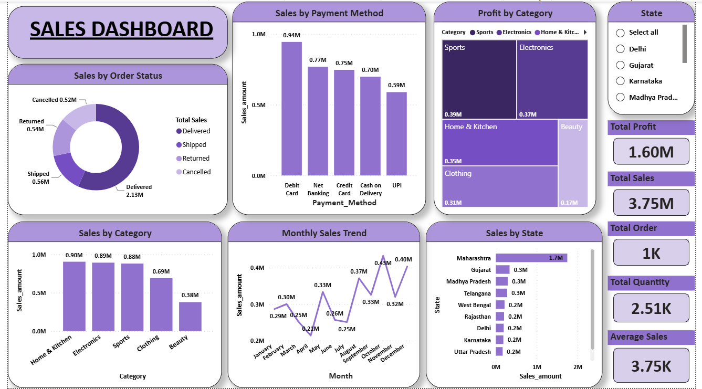
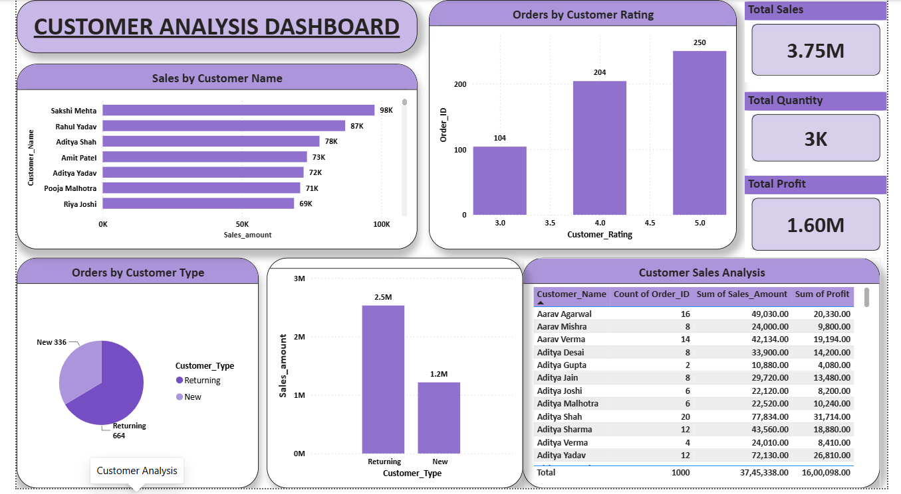

**E-commerce Sales & Customer Analysis**

# Project Overview
This project focuses on analyzing e-commerce sales and customer data using **Microsoft Excel, MySQL, and Power BI**. The goal is to explore sales performance, customer behavior, product trends, and business insights through data analysis and interactive dashboards.

# Tools & Technologies
- **Microsoft Excel:** Data cleaning, preparation, and initial analysis
- **MySQL:** Data storage, SQL queries, joins, subqueries, aggregations, and CTEs
- **Power BI:** Interactive dashboards, data visualization, and DAX measures

# Project Workflow
1. Imported and explored the e-commerce dataset in Excel.
2. Cleaned and prepared the data.
3. Loaded the data into MySQL for querying and analysis.
4. Performed SQL-based analysis to identify sales and customer trends.
5. Connected the cleaned data to Power BI.
6. Created interactive dashboards using charts, KPI cards, and visualizations.

# Dashboard Pages
 1. Sales Overview
- Total Sales
- Total Profit
- Total Orders
- Total Quantity
- Average Sales
- Monthly Sales Trend
- Sales by State
- Sales by Category
- Profit by Category
- Sales by Payment Method
- Sales by Order Status

 2. Customer Analysis
- Customer Sales Analysis
- Orders by Customer Rating
- Orders by Customer Type
- Sales by Customer Type
- Customer Details and Sales Summary
- 
# Power BI Dashboard Screenshots

# Sales Overview

# Customer Analysis

# SQL Concepts Used
- SELECT, WHERE, ORDER BY
- GROUP BY and HAVING
- Aggregate Functions
- CASE Statements
- Joins
- Subqueries
- Common Table Expressions (CTEs)
- Data Cleaning and Transformation

# Key Learning Outcomes
- Hands-on practice with data cleaning and preparation.
- Improved SQL querying and analytical skills.
- Created KPI measures using DAX.
- Built interactive Power BI dashboards.
- Developed an understanding of sales and customer data analysis.

# Project Files
- `Ecommerce_Project.pbix` – Power BI dashboard
- `Ecommerce_project.sql` – SQL queries
- `Ecommerce_project.xlsx` – Excel dataset

# Conclusion
This project helped me gain practical experience in the end-to-end data analysis process, from data preparation and SQL analysis to dashboard development using Power BI.

**Created by**:Rakhi Verma
